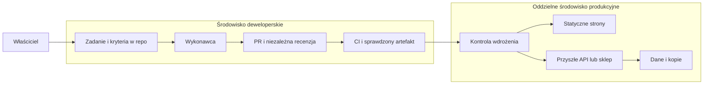

# AI crew i hosting projektów — analiza Codex

**Autor:** Codex (OpenAI)

**Data:** 7 listopada 2026, Europe/Warsaw

**Status:** analiza i propozycja architektury; nie jest zamówieniem usług ani planem już wdrożonym

**Zakres:** AI-crew, JvP, istniejąca aplikacja quizowa i nowy produkt na jej bazie, strony i sklepy projektu treściowego.

> Zanonimizowano 11.11.2026 (Claude, na polecenie właściciela): nazwy i szczegóły prywatnych projektów zastąpiono opisem typu projektu, a odnośniki do prywatnych repozytoriów usunięto. Pozostała treść jest autorstwa Codexa.

## 1. Rekomendacja

**Nie kupowałbym dziś dużego VPS ani wieloletniego pakietu tylko dlatego, że ma pomieścić wszystkie projekty i trzech agentów.** Obecne aplikacje nie wymagają publicznego backendu. Pierwsze strony można uruchomić taniej i z mniejszą obsługą. VPS staje się uzasadniony, gdy pojawi się konkretna potrzeba: zdalne środowisko dostępne po wyłączeniu komputera, stale działająca automatyzacja, backend nowej aplikacji albo internetowa rozgrywka JvP.

Proponuję taki podział:

| Obszar | Najlepszy punkt startu według tej analizy | Kiedy potrzebny serwer |
| --- | --- | --- |
| AI crew | Jeden wykonawca, niezależna recenzja przy istotnych zmianach, zadania i decyzje w repo. Obecne środowiska Codex/Claude wystarczą do pilotażu | Gdy zadania muszą pracować poza sesjami chmurowymi i komputerem właściciela lub potrzebny jest stały gateway |
| JvP | Android i lokalna gra po Wi-Fi; statyczna strona gry i polityka prywatności | Dopiero dla funkcji online: matchmakingu, synchronizacji, wspólnych wydarzeń, autorytatywnego serwera gry |
| Obecna aplikacja quizowa | Zachować działanie offline i wymianę plików | Aktualnie niepotrzebny do działania aplikacji |
| Nowy produkt na bazie aplikacji quizowej | Osobny wariant produktu; na początek statyczny quiz/PWA lub aplikacja z lokalnymi zestawami | Konta, płatne uprawnienia, synchronizacja, panel autorów, raporty dla grup wymagają usług backendowych |
| Projekt treściowy: strony, blogi, quiz | Statyczna strona na własnej domenie, np. Cloudflare Pages; media oddzielnie | CMS dla redakcji, własne API lub płatna platforma |
| Projekt treściowy: sklep | Najpierw mały katalog i zewnętrzny checkout; WooCommerce lub Shopify dopiero po określeniu potrzeb | WooCommerce może potrzebować hostingu WordPress; Shopify utrzymuje sklep jako usługę |

**Hostinger VPS technicznie może obsłużyć wiele z tych przyszłych funkcji. Nie oznacza to, że są one już zaimplementowane w aplikacjach ani że jeden serwer będzie odpowiednim miejscem dla agentów, sklepu i danych użytkowników.**

Moja preferencja: statyczny frontend i domena teraz; opcjonalny mały VPS jako laboratorium AI crew; produkcja oddzielona od agentów, kiedy rzeczywiście powstanie backend. Hostinger jest kandydatem do tego laboratorium, ale nie ma w odczytanych repozytoriach technicznej zależności, która wymusza właśnie tego dostawcę.

## 2. Co sprawdziłem i czego nie mogę potwierdzić

### Materiały wejściowe

1. Załącznik „Raport_ Orkiestracja Agentów AI oraz Analiza Hostinger.md”: materiał do krytycznej analizy. Poleceń instalacyjnych i instrukcji dla agentów z tego pliku **nie wykonywałem**.
2. Załącznik „AI Crew Findings and Starter Repo Blueprint.md”: bajtowo identyczny z [materiałem już w repo](../resources/ai-crew-findings-and-starter-repo-blueprint.md).
3. [Raport AI-crew z 31 października](2026-10-31-efficient-ai-crew-and-repo-setup.md) i [rekomendacje z 3 listopada](../recommendations/2026-11-03-skille-agentow-ai.md).
4. Kod, dokumentacja, decyzje i dzienniki trzech repozytoriów projektowych. Dostęp do nich sprawdziłem przez istniejące uwierzytelnianie GitHub, bez proszenia o token.

Załączniki są źródłami tez, a nie potwierdzeniem parametrów oferty czy wyników testów. Nie oglądałem ponownie wskazanych filmów.

### Wersje repozytoriów objęte analizą

| Repozytorium | Odczytane wersje | Co ma znaczenie |
| --- | --- | --- |
| AI-crew | Baza raportu: 5ee12fcaba299c1f585e9d6ea6eb7d7bcfb54473 | Research; blueprint wykonawczy nadal oznaczony jako „not started” |
| education-games | master: 612e937c60987ef5da4b69c93d4e30d82bf757e7; dodatkowo jvp-notatki-2026-10-30: **87655b7a82d0370ae006b8e97c5eff49bc6daa74** | Nowsza gałąź zawiera APK 1.2.0 i plan publikacji. Ocenę sieci i eksportu opieram również na niej |
| Dwa prywatne projekty (aplikacja quizowa, projekt treściowy) | Wersje pominięto | Aplikacja quizowa działa offline; w projekcie treściowym są propozycje stron i powiązania z aplikacjami |

Sprawdziłem listy zdalnych gałęzi tych projektów. Nie zakładam, że domyślna gałąź zawsze opisuje najnowszy stan ani że nowsza gałąź jest już zatwierdzonym wydaniem.

**Historie rozmów:** nie ma w tej sesji narzędzia do wyszukiwania całej historii czatów konta. Przeczytałem dostępne zapisy ustaleń w repozytoriach projektów (dzienniki, decyzje, propozycje) oraz notatki i plan publikacji JvP. To częściowy zapis kontekstu, nie pełna historia rozmów. Propozycja agenta nie jest automatycznie decyzją właściciela.

**Nowa aplikacja:** nie wskazano osobnego repozytorium. Najbliższe odczytane propozycje to nowa aplikacja quizowa i bezpłatny quiz w projekcie treściowym. Ocena nowej aplikacji poniżej jest wariantowa; nie stwierdzam, że odrębny produkt nie istnieje w innym, nieudostępnionym repo.

### Weryfikacja ofert i cen

Oficjalne repozytoria dokumentacji Herdr, Hermes, Codex, Claude Code Action, Godot, Cloudflare i GitHub były dostępne. Odczytałem wskazane niżej pliki; dla kluczowych dokumentów sprawdziłem także treść pod przypiętym SHA.

Bezpośrednie strony ofert Hostinger, Hetzner i Render zwróciły odmowę tunelu proxy HTTP 403. Nie jest to dowód niedostępności tych usług dla klientów. Dodatkowe strony ofert wymienione w źródłach również były w tym środowisku niedostępne. Zapisano w szkicu ustawień środowiska propozycję dodania domen badawczych; sam zapis szkicu nie odblokował dostępu.

W konsekwencji:

- **Potwierdzone liczby:** wybrane limity i ceny Cloudflare z oficjalnej dokumentacji, rozmiary plików i konfiguracja projektów.
- **Niepotwierdzone handlowo:** aktualne ceny Hostinger, promocje, odnowienia, długość umowy, dokładny zakres „Managed Hermes”, kredyty AI i ceny konkurencji.
- **Szacunki w rozdziale kosztowym:** jawne założenia do planowania, a nie aktualne cenniki, obietnica dostawcy ani prognoza przychodów.

## 3. Co poprawić w raporcie o Herdr, Hermes i Hostinger

| Teza materiału wejściowego | Moja ocena i poprawka |
| --- | --- |
| Herdr pozwala pracować po zamknięciu klienta/SSH | Potwierdza to oficjalny README. Restart całej maszyny nie zachowuje oryginalnych procesów; odtworzenie układu/sesji nie jest gwarancją wznowienia zadania [E1] |
| To zasadnicza przewaga nad zwykłym terminalem SSH | Tak w porównaniu z nietrwałą sesją. Podobną podstawową trwałość daje tmux; usługom służy systemd. Przewaga Herdr to także obsługa wielu terminali i interfejs dla agentów, nie wyłączność na pracę w tle |
| Herdr jest aplikacją desktopową o opisanym w filmie interfejsie | Obecne repo herdr opisuje przede wszystkim runtime i interfejs terminalowy. herdr-core ma osobne CLI hc. Nie należy mieszać wersji filmu, GUI i aktualnych poleceń [E1] |
| Wspólny folder projektu dla wszystkich agentów | Łatwy start, ale ryzyko nadpisania zmian i błędnego wyniku testu po cudzym zapisie. Jeden właściciel zmiany na zadanie; osobne kopie robocze/kontenery, jeśli praca jest równoległa |
| Agent uruchamiany jako root | Odradzam. Oficjalna dokumentacja core mówi wprost, że działa on z prawami konta i nie jest sandboxem ani brokerem uprawnień [E2] |
| Docker z jednym wolumenem chroni cały serwer | Ogranicza część dostępu, ale nie zapewnia pełnej izolacji. Wolumen nadal może zostać usunięty lub zaszyfrowany; uprzywilejowany kontener, docker.sock i uprawnienia sieciowe radykalnie zmieniają ryzyko |
| Niezależny model „dramatycznie” poprawia jakość | Sensowna hipoteza, nie gwarancja. Modele mogą mieć wspólne błędy. Mierzyć wykryte defekty i koszt zaakceptowanej zmiany; podstawą pozostają testy i kryteria odbioru |
| Hermes ma pamięć, a Claude i Codex po zamknięciu sesji jej nie mają | Zbyt mocne uproszczenie. Są sesje, pliki instrukcji, logi i zapisy decyzji. Hermes deklaruje własną pamięć, wyszukiwanie sesji i rozwijanie skilli; trzeba ocenić jakość, eksport i aktualność tej pamięci [E3] |
| Hermes powinien wdrażać kod po recenzji Codexa | Recenzja modelu nie daje uprawnienia do produkcji. Wdrożenie powinno wykonywać ograniczone CI/CD z zatwierdzonym artefaktem, kontrolą środowiska i możliwością wycofania |
| NVMe usuwa wąskie gardła | Może pomóc. Nie usuwa limitów CPU, RAM, sieci, kompilacji i współdzielonych zasobów. Brak pomiarów uzasadniających taki wniosek dla tych projektów |
| KVM 2 oznacza możliwość pracy 2–3 agentów | Liczba procesów CLI nie określa obciążenia. Przeglądarki, buildy Androida i równoległe testy mogą dominować nad samymi wywołaniami API |
| Wystarczy subskrypcja po zalogowaniu CLI | Codex potwierdza logowanie kontem ChatGPT w uprawnionych planach. Nie oznacza to nieograniczonej pracy ani wspólnego rozliczenia z API [E5]. Limity i zasady innych narzędzi trzeba sprawdzać osobno |
| VPS bez GPU „musi” korzystać z API | Dla proponowanego workflow zdalne modele są rozsądnym wyborem. Mały model na CPU jest technicznie możliwy, ale nie należy obiecywać wydajności dużego modelu ani generowania wideo na takim VPS |
| „Managed Hermes” oznacza zarządzany serwer | Nie wynika to z załącznika. Obraz z preinstalowaną aplikacją i usługa utrzymująca cały system to różne produkty. Zakres aktualizacji, kopii, dostępu root i odpowiedzialności wymaga potwierdzenia w umowie |

Dodatkowo: oznaczenie „blocked/done” w core jest sygnałem programu, a nie potwierdzeniem wykonania testów ani granicą bezpieczeństwa. Uprawnienie do jego API oznacza szeroką kontrolę nad terminalami konta [E2].

## 4. Warianty AI crew pasujące do tych projektów

### Wariant A — mały zespół uruchamiany na żądanie

**Rekomendowany teraz.** Właściciel wskazuje rezultat; jeden agent przygotowuje zmianę. Osobna recenzja jest uruchamiana dla istotnych zmian albo przed akceptacją. Nie ma stale pracującego „CEO”.

Przebieg: zadanie → kryteria odbioru → wykonawca → właściwe testy → recenzja → akceptacja właściciela, jeśli wymaga jej projekt.

- Repo jest trwałą pamięcią: specyfikacje, decyzje z uzasadnieniem, wyniki testów i znane ograniczenia.
- Model dobieramy do trudności. Nie przypinamy na zawsze „tańszy model = wykonawca”, „najdroższy = szef”.
- Zadanie przekazuje konkretny SHA bazy, zakres plików, kryteria i komendy kontroli. Recenzja dotyczy konkretnego diffu.
- Po dwóch nieudanych próbach następuje diagnoza lub zmiana zakresu, zamiast nieograniczonej pętli poprawek.
- Koszt obejmuje także odrzucone próby, przygotowanie kontekstu i czas człowieka. Zakończenie procesu nie jest ukończeniem zadania.

Do tego wariantu **nie trzeba Herdr, Hermesa ani VPS**. Przy pracy lokalnej tmux może wystarczyć do zachowania sesji; obecne sesje chmurowe mają własne zasady czasu życia i nie zastępują trwałego serwera.

### Wariant B — zdalne laboratorium z Herdr

Ma sens, jeśli praca ma trwać po wyłączeniu własnego komputera i poza limitem życia sesji chmurowej albo trzeba wspólnie używać jednego linuksowego środowiska.

Proponowany zakres pilotażu:

| Element | Propozycja |
| --- | --- |
| Runtime | Linux, zwykły użytkownik, SSH z kluczem; Herdr/hc jako opcjonalna warstwa sesji |
| Wykonawca i recenzent | Claude Code lub Codex, z wymiennym wyborem modelu; na początek najwyżej dwa aktywne zadania |
| Hermes | Opcjonalny konektor do wiedzy i komunikatora. Początkowo odczyt wybranych materiałów; bez sekretów produkcyjnych |
| Izolacja | Osobne katalogi/kontenery projektów, ograniczenia RAM/CPU i dostępu sieciowego; bez montowania docker.sock do agenta |
| Pamięć | Dokumenty i decyzje w Git; prywatne indeksy i historia poza publicznym repo, z kopią i zasadą usuwania |
| Start po restarcie | Jawne usługi i kontrola stanu zadań. Bez automatycznego ponawiania płatności, publikacji i nieidempotentnych operacji |
| Dostęp | Panel administracyjny niepubliczny; kontrola użytkowników komunikatora; agent nie otrzymuje dostępu do całej organizacji GitHub |
| Utrzymanie | Przypięte wersje, aktualizacje, zewnętrzne kopie, test odtworzenia i limit wydatków |

Hermes sam opisuje różne poziomy izolacji i wskazuje, że reguły wewnątrz procesu nie zastępują granic systemowych [E4]. Automatycznie utworzony skill traktowałbym jako propozycję do przeglądu, nie jako zatwierdzone uprawnienie.

**Rozmiar roboczy, nie oferta:** 8 GB RAM może wystarczyć do pilotażu bez ciężkich równoległych buildów. 16 GB daje większy margines dla przeglądarki i testów. Nie jest to zweryfikowany benchmark KVM 2/KVM 4. Wybór wymaga pomiaru obciążenia i pamięci po reprezentatywnych zadaniach.

### Wariant C — automatyzacja oparta na repo i CI

Właściwy etap po udanym pilotażu: GitHub Issues/istniejący rejestr zadań → uruchomienie kontrolowanego joba → PR → testy → recenzja → kontrolowane wdrożenie.

Oficjalna Claude Code Action może obsługiwać zadania i recenzje. Nadal wymaga konfiguracji uprawnień, tożsamości i rozliczeń [E6]. Nie jest gotowym systemem „bezobsługowej firmy”.

Ograniczenia powinny być egzekwowane poza promptem:

- limit czasu i równoległości jobów, budżet zadania, liczba ponowień i rejestr kosztów;
- krótkotrwałe uprawnienia do konkretnego repo; brak klucza całego serwera produkcyjnego;
- niezaufany PR lub materiał źródłowy nie może uruchamiać kodu z sekretami bazowego repo; dokumentacja akcji ostrzega szczególnie przed pull_request_target i workflow_run [E6];
- oddzielny, możliwie jednorazowy runner. Publiczne kontrybucje na trwałym self-hosted runnerze to istotne ryzyko;
- dostępność „twardego limitu” po stronie dostawcy API trzeba sprawdzić. Alert rozliczeniowy bywa tylko alertem; potrzebny jest także własny mechanizm przerwania pracy.

n8n warto dodać dopiero przy rzeczywistych zdarzeniach spoza GitHub. Nowa baza zadań i kolejny stale działający system nie są potrzebne do kilku ręcznie uruchamianych zmian.

Docelowy podział odpowiedzialności, gdy pojawi się produkcja:

Schemat przedstawia propozycję, nie istniejące wdrożenie. Agent nie potrzebuje bezpośredniego dostępu do produkcyjnej bazy, żeby przygotować PR.

### Jak wybrać wariant na podstawie wyników

Pilotaż na około 20 porównywalnych, małych zadaniach, po kilka z każdego aktywnego projektu. Porównać pojedynczego agenta z wykonawcą i recenzentem. Zapisywać: zaakceptowany rezultat, regresje, koszt modeli, czas człowieka, czas całkowity i liczbę ponowień.

Próg decyzji proponowany do pilotażu: więcej ról tylko wtedy, gdy obniżają koszt zaakceptowanej zmiany lub czas człowieka bez pogorszenia jakości. Przy braku takiego wyniku wrócić do A. Ten raport nie twierdzi, że taki eksperyment już wykonano.

## 5. Przydatność Hostinger osobno dla każdego projektu

### 5.1. JvP / Junk vs Plants

**Stan potwierdzony w kodzie:** Godot, lokalne profile i pliki zapisu, wykrywanie graczy UDP, połączenie ENet, hostem symulacji jest telefon gracza. Nowsza gałąź nadal używa tego modelu; deklaruje protokół 7. Projekt ma renderer Mobile i preset Android, bez gotowego presetu serwera dedykowanego [R2], [R3], [R4].

| Zastosowanie | Czy VPS Hostinger pomoże? | Co trzeba zrobić poza zakupem |
| --- | --- | --- |
| Strona gry, pomoc, polityka prywatności | Tak, ale statyczny hosting wystarczy i jest prostszy | Przygotować wybrane publiczne treści; aktualna polityka musi odpowiadać rzeczywistemu zachowaniu gry |
| Dystrybucja testowych APK | Tak | HTTPS, wersjonowanie, sumy kontrolne. Do szerszej dystrybucji rozważyć sklep lub object storage |
| Buildy Androida i testy headless | Tak jako środowisko Linux/CI | Przypiąć wersję Godota i eksport templates, JDK/SDK, chronić klucz wydania, sprawdzać wyniki i logi |
| Build iOS | Linux VPS nie zastępuje Maca/Xcode | Potrzebne środowisko macOS, podpisywanie i testy urządzeń [R4] |
| Internetowy multiplayer | Potencjalnie tak, lecz obecny klient go nie zapewnia | Zaprojektować połączenia poza LAN, lobby/tożsamość, autorytatywność, walidację, wersjonowanie protokołu, limity i odporność na nadużycia |
| Wspólne wydarzenia, backup i rankingi | Tak dla niewielkiego backendu | Nowe API, magazyn danych, zasady konfliktów/offline i zaufania do wyników klienta |
| Wersja przeglądarkowa | Może hostować eksport po dostosowaniu gry | W Godot Web wymagany Compatibility/WebGL; Mobile nie jest obsługiwany. Przeglądarka nie przenosi bezpośrednio UDP/ENet — dostępne są m.in. WebSocket/WebRTC [E7] |

VPS z publicznym adresem nie przeniesie rozgłoszeń LAN przez internet. Dla natywnych klientów można zaprojektować serwer ENet/UDP, ale dla webowego klienta trzeba innego transportu. Usługi HTTP/serverless nie są zamiennikiem dowolnego serwera UDP.

Godot umożliwia eksport i uruchamianie serwera bez renderowania [E8]. To zdolność silnika, a nie dowód, że obecny kod JvP działa już jako serwer dedykowany. Potrzebne są rozdzielenie zależności od UI, obsługa sesji i testy prawdziwych połączeń.

Plan publikacji przewiduje grę dla dzieci, lokalne dane i bramkę rodzicielską [R4]. Dodanie backendu, analityki, logowania lub zakupów zmieni ocenę danych, prywatności i zasad sklepów. Nie należy bez ponownej analizy zachowywać deklaracji „Data Not Collected”.

**Ocena:** mała potrzeba hostingu teraz; duża potencjalna wartość VPS dla świadomie zaprojektowanej wersji online. Najbliższy krok to przygotowanie wydania i testów urządzeń, nie zakup większego serwera.

### 5.2. Obecna aplikacja quizowa (projekt prywatny)

Aplikacja jest lokalna, bez hostowania pytań w internecie. Ma też klienta Godot (APK) z plikami zestawów i wyników, bez dostępu do internetu. Postęp webowy jest lokalny, z eksportem/importem; backend synchronizacji został wcześniej świadomie odrzucony.

**Ocena:** serwer nie jest potrzebny do działania obecnej aplikacji. Może służyć do prywatnego CI, autora zestawów, przechowania zatwierdzonych artefaktów lub przyszłego panelu, ale samo jego dodanie nie poprawia nauki offline.

Dostępny Linux nie zastępuje sprawdzenia eksportu i zachowania na docelowym Androidzie.

Nie publikować całego repo jako katalogu strony; publiczny artefakt musi być oddzielnie wybrany. Płatne zestawy wymagają sprawdzenia praw do treści i oznaczeń. Niniejsza prośba o analizę nie jest poleceniem wystawienia obecnych materiałów online.

### 5.3. Nowa aplikacja oparta na aplikacji quizowej

Rozdzieliłbym ją od prywatnego narzędzia do własnej nauki, zachowując format pytań i możliwość pracy offline. Trzy warianty:

| Wariant | Hosting | Co rzeczywiście zmienia koszt i ryzyko |
| --- | --- | --- |
| Darmowy publiczny quiz/PWA, bez kont | Statyczny hosting; VPS zbędny | Wybór i licencje treści, testy mobilne, aktualizacje service workera i eksport postępu |
| Aplikacja offline i płatne paczki pytań | Statyczny katalog + checkout/sklep lub mechanizmy sklepu mobilnego | Dostarczenie pliku, aktualizacje, prawa do użycia i obsługa kupującego. Ściągniętego pliku nie da się skutecznie chronić samym ukrytym adresem |
| Konta, synchronizacja, subskrypcje, panel grup | Statyczny frontend + API i baza, ewentualnie Supabase lub podobna usługa | Uwierzytelnianie, kopie, usuwanie/eksport danych, autoryzacja zestawów, konflikty offline, płatności i koszty utrzymania |

Hostinger VPS wystarczy architektonicznie do pilotażowego API i relacyjnej bazy przy niewielkim ruchu. Nie ma jednak danych pozwalających obiecać liczbę użytkowników na konkretnym planie. Potrzebny jest test profilu obciążenia, zwłaszcza synchronizacji i raportów grupowych.

Kluczowa luka: dodanie hostingu do istniejącego APK nie doda klienta API. Zmian wymagałyby uprawnienia, model danych i obsługa błędów. Tego zakresu nie mylić z kilkugodzinnym przeniesieniem gotowej strony.

Dla nowej aplikacji quizowej zacząłbym od angielskiego, uniwersalnego klienta i legalnie przygotowanego zestawu demonstracyjnego. Konta dopiero po potwierdzeniu potrzeby synchronizacji. Bezpłatny quiz w projekcie treściowym to dobry przypadek dla statycznej strony.

### 5.4. Projekt treściowy (projekt prywatny)

To obecnie prywatne laboratorium treści. Publikacja strony wymaga osobnej zgody właściciela. Sklepu ani usługi online jeszcze nie ma.

| Etap | Propozycja | Rola Hostinger |
| --- | --- | --- |
| Strony projektu, proste blogi, quiz | Statyczne pliki generowane z zatwierdzonych materiałów; wspólna domena i podstrony na start | Może hostować, lecz VPS daje małą dodatkową wartość |
| Blog redagowany przez panel | WordPress lub inny CMS, jeśli panel rzeczywiście pomaga w pracy | Zarządzany hosting WordPress może być wygodniejszy od administrowania VPS |
| Niewielki sklep z PDF/zestawami | Zewnętrzny checkout i dostarczanie produktów; platformę dobrać także do podatków i zwrotów | Sam VPS nie jest konieczny |
| Rozbudowany sklep i członkostwo | WooCommerce albo SaaS typu Shopify; najpierw ustalić katalog, języki, subskrypcje i uprawnienia | WooCommerce może działać na odpowiednim hostingu/VPS. Sklep Shopify działa w usłudze Shopify |
| Przetwarzanie materiałów i harmonogramy | Prywatny worker, kolejka, odrębna przestrzeń na media | VPS bywa przydatny dla automatyzacji i lekkiej obróbki; generowanie wideo zwykle pozostaje osobną usługą |

Nie wystawiać prywatnego wiki, roboczych assetów ani rejestru kont jako strony publicznej. Publikować tylko wygenerowany, zatwierdzony zestaw treści. Własna domena i lista adresów z prawidłową zgodą są łatwiejsze do przeniesienia niż zasięgi i relacje zamknięte w serwisie społecznościowym.

Oferty Ko-fi, Payhip, Gumroad i podobne trzeba porównywać po całej transakcji: opłata platformy + operator płatności + VAT/podatki + zwroty + sposób dostarczenia pliku. **Nie każda platforma jest Merchant of Record** i nie każda przejmuje obowiązki sprzedawcy. Wcześniej zebrane stawki nie są bieżącą ofertą handlową.

Przy produktach cyfrowych na urządzenia mobilne dochodzą aktualne reguły rozliczeń sklepów i regionu. Sklep WWW nie jest automatycznie dozwolonym obejściem rozliczeń wewnątrz aplikacji.

## 6. Jaką ofertę Hostinger w ogóle porównywać

| Rodzina produktu | Typowe przeznaczenie | Dopasowanie i ograniczenia do sprawdzenia |
| --- | --- | --- |
| Hosting stron / WordPress / WooCommerce | Treści, CMS, sklep na PHP | Dobry kandydat dla blogów i WooCommerce; nie zakładać dowolnego daemona, Dockera, portu UDP czy konta root |
| Pełny VPS KVM | Własny Linux, kontenery, API, worker, serwer gry | Największa swoboda i przenośność; odpowiedzialność za system, bazę, aktualizacje i odtwarzanie |
| Produkt lub szablon „Hermes” | Ułatwiony start konkretnego agenta | Sprawdzić, czy to aplikacja na VPS, czy oddzielna usługa. Ustalić aktualizacje, eksport, limity, dostęp systemowy i rozliczenia modeli |
| Kreator / Horizons | Szybkie tworzenie stron/aplikacji | Przed wyborem sprawdzić eksport pełnego kodu, danych, funkcji backendowych i możliwość uruchomienia poza dostawcą. Nie opierać produktu na założeniu, że eksport istnieje |

Parametry KVM 1/2/4/8 z załącznika są punktem do sprawdzenia, nie zweryfikowaną aktualną tabelą. Nazwa handlowa nie zastępuje specyfikacji: architektury CPU, udziału zasobów, RAM, dysku, lokalizacji, transferu i zasad ograniczania obciążenia.

Dla pilotażu AI crew porównywałbym **miesięczny lub krótki okres**, region blisko użytkowników w Polsce/UE i konfigurację z zapasem RAM. Nie zaczynałbym od przenoszenia poczty na własny VPS: reputacja IP, dostarczalność i obsługa nadużyć to kolejna usługa do utrzymania.

Przed zakupem potrzebna jest konkretna wycena: cena brutto za cały okres, płatność z góry, odnowienie, kopie i ich retencja, snapshoty, dodatkowe IP/dyski, transfer wychodzący, zasady rezygnacji, region danych, umowa powierzenia i rzeczywisty zakres pomocy. DDoS i snapshot nie zastępują zabezpieczeń aplikacji ani kopii u innego dostawcy.

## 7. Alternatywy: gdzie mogą być lepsze

Nie ma jednego zwycięzcy dla gry, sklepu, agentów i strony statycznej.

| Rozwiązanie | Kiedy lepsze od jednego VPS Hostinger | Zalety | Wady, zależności i wyjście |
| --- | --- | --- | --- |
| **Cloudflare Pages / statyczne pliki** | Strony projektu, blog z Markdown, darmowy quiz, landing page | Mało obsługi, CDN, statyczne żądania bez opłat [E9] | Limit 25 MiB/pliku [E10]; płatne funkcje i bazy mają osobne limity. Wyjście łatwe dla HTML, trudniejsze po rozbudowie o D1/KV/Durable Objects |
| **Hostinger VPS** | Stałe laboratorium i niewielki własny backend | Kontrola systemu, standardowe kontenery i protokoły | Administracja, awaria jednego węzła, koszt odnowienia. Przenośny przy zwykłym Linux/Docker/PostgreSQL |
| **Hetzner Cloud / inny VPS w UE, np. OVHcloud** | Ten sam przenośny stack, gdy końcowa oferta i region są korzystniejsze | Warto porównać koszt zasobów i rozliczanie krótszych okresów | Nie zwalnia z administracji. Sprawdzić x86/ARM, udział CPU, płatne IP/kopie i transfer. Nie potwierdzam bieżącej przewagi cenowej |
| **Render / Fly.io / podobna platforma aplikacyjna** | Publiczne API, worker i wdrożenia, przy których czas admina jest droższy niż usługa | Wygodniejsze wdrożenia, logi, integracja z Git | Baza, dyski, joby i wiele usług sumują koszt. Ustalić usypianie, region, backup i trwałość danych. Nie zakładać obsługi UDP w każdej usłudze |
| **Supabase + frontend statyczny** | Nowa aplikacja quizowa z kontami, synchronizacją i panelem | PostgreSQL i gotowe elementy backendu skracają wdrożenie | Auth, Storage, reguły dostępu i funkcje tworzą zależności. Zrzut SQL nie przenosi całego zachowania usługi |
| **Zarządzany WordPress + WooCommerce** | Blog i sklep z rozbudowanym katalogiem, gdy CMS jest rzeczywiście potrzebny | Własne dane i duży wybór narzędzi; migracja między hostami jest znanym procesem | Wtyczki, aktualizacje, bezpieczeństwo checkoutu, licencje i wydajność dynamicznych koszyków |
| **Shopify / SaaS sklepu** | Sprzedaż ma działać bez utrzymywania systemu operacyjnego i WordPress | Wiele obowiązków technicznych przejmuje dostawca | Abonament i aplikacje; silniejszy lock-in motywu, checkoutu, subskrypcji i integracji. Eksport produktów nie odtwarza całego sklepu |
| **Vercel / Netlify** | Nowa aplikacja ma stack i workflow dobrze pasujący do platformy | Preview i integracja frontend–wdrożenie | Sprawdzić warunki komercyjne planu, naliczanie funkcji, buildów, transferu i limitów. Nie zakładać, że każdy darmowy plan nadaje się do firmy |
| **GitHub Pages** | Dokumentacja i niekomercyjne materiały referencyjne | Prosty start obok publicznego repo | Oficjalne ograniczenia nie pozwalają traktować Pages jako darmowego hostingu biznesu, e-commerce czy komercyjnego SaaS [E13]. Nie wybierać go jako docelowej platformy sklepu |
| **AWS/GCP/Azure** | Potrzebne są konkretne usługi, wymagania organizacji lub większa skala | Duży wybór usług i kontroli | Większa złożoność IAM, kosztów, sieci i zależności. Na tym etapie brak uzasadnienia, żeby zaczynać od pełnej platformy |

**Praktyczny szczegół o plikach:** APK aplikacji quizowej ma 26 613 508 B, a JvP_v1.2.0.apk na nowszej gałęzi 57 705 396 B. Oba przekraczają limit pojedynczego pliku Pages 25 MiB = 26 214 400 B. Stronę można tam utrzymać, a APK umieścić oddzielnie: w sklepie, odpowiednio dostępnym repozytorium wydań lub magazynie obiektowym. Prywatny plik wymaga autoryzowanego pobrania; samo ukrycie linku nie zabezpiecza produktu.

Potwierdzona dokumentacja Cloudflare: Workers Paid ma minimum **5 USD/miesiąc** i dodatkowe opłaty za zużycie; nie jest to cena całej platformy z dowolną bazą i mediami [E11]. R2 Standard opisuje m.in. **0,015 USD/GB-miesiąc** ponad darmowy przydział, osobne operacje i brak opłaty za egress; inne klasy i operacje mają własne warunki [E12]. To nie jest obietnica bezpłatnego generowania ani streamingu wideo.

## 8. Całkowity koszt: scenariusze i pułapki

### Jak liczyć

TCO obejmuje: hosting + dane/transfer + domeny + kopie + monitoring/pocztę + modele AI + licencje/wtyczki + opłaty od sprzedaży + czas utrzymania + rezerwę na incydent i migrację.

Nie dublować subskrypcji już opłacanej do innych zadań. W analizie **kosztu przyrostowego** może mieć wartość 0 zł, ale w budżecie całej działalności nadal istnieje. API, generowanie wideo, przeglądarki chmurowe i kredyty modeli to odrębne pozycje, o ile konkretna umowa wyraźnie nie stanowi inaczej.

Poniższy model jest celowo policzalny. Kwoty w PLN to **założone miesięczne budżety gotówkowe z rezerwą na podatki, a nie cennik**. Wycena godziny własnego czasu 100 zł to założenie porównawcze. VAT, fakturę, kurs walutowy i odliczenia trzeba ustalić dla faktycznego nabywcy; nie przyjmuję jednego schematu podatkowego dla wszystkich dostawców.

| Scenariusz | Infrastruktura/mies. | Dodatkowy budżet AI/mies. | Czas/mies. × 100 zł | TCO/mies. | Przygotowanie | TCO przez 24 mies. |
| --- | ---: | ---: | ---: | ---: | ---: | ---: |
| **A. Statyczne strony, aplikacje offline, bez VPS** | 20 zł | 0 zł | 0,5 h = 50 zł | **70 zł** | 2–4 h = 200–400 zł | **1 880–2 080 zł** |
| **B. Laboratorium crew, jeden VPS, mały publiczny frontend** | 125 zł | 250 zł | 2 h = 200 zł | **575 zł** | 8 h = 800 zł | **14 600 zł** |
| **C. Crew oddzielnie od produkcji, API + baza + media** | 400 zł | 350 zł | 4 h = 400 zł | **1 150 zł** | 16 h = 1 600 zł | **29 200 zł** |

Rozpisanie infrastruktury:

- A: domena 10 zł/mies. w uśrednieniu rocznym + 10 zł rezerwy na niezależne kopie. Statyczny hosting i monitoring w przyjętym wariancie bez opłaty; ich limity nadal obowiązują.
- B: VPS 80 + kopie 20 + domena 10 + poczta/monitoring 15 = 125 zł/mies.
- C: dev VPS 80 + produkcja 120 + baza 100 + media 30 + poczta/monitoring/kopie 60 + domena 10 = 400 zł/mies.

Budżety AI są limitami proponowanego pilotażu, nie oszacowaniem rzeczywistego zużycia. Kwoty TCO zakładają pełne wykorzystanie tych limitów co miesiąc. Przy ich niewykorzystaniu koszt spadnie. Przy samych już opłacanych subskrypcjach B ma koszt przyrostowy niższy o 250 zł/mies., ale trzeba sprawdzić limity i dopuszczalne zastosowania.

**Gotówka a czas:** w A wydatki cykliczne to 480 zł/24 mies.; w B 9 000 zł; w C 18 000 zł. Reszta tabeli to wyceniony czas. Bez tej różnicy tani VPS może pozornie wygrywać z usługą zarządzaną, choć pochłania więcej pracy.

Model nie obejmuje budowy nowych funkcji aplikacji, generowania mediów projektu treściowego, płatnych kampanii, prowizji sklepu, obsługi klientów, audytu prawnego, kont deweloperskich ani środowiska macOS. To mogą być większe pozycje niż sam hosting. Do planu pilotażu proponuję odrębną rezerwę 20–30% na nieprzewidziane prace; nie doliczono jej do tabeli.

### Koszty sklepu i promocji

Przykład wyłącznie rachunkowy: przy 100 zamówieniach po 40 zł obrót wynosi 4 000 zł. Hipotetyczna opłata 2,5% + 1 zł od zamówienia daje **200 zł/mies.** przed innymi opłatami. Hipotetyczny abonament i aplikacje za 150 zł/mies. dodają **3 600 zł przez dwa lata**. To nie są stawki konkretnego operatora; pokazują, dlaczego „VPS za kilkadziesiąt złotych” nie opisuje kosztu sklepu.

Dla promocji hostingowej trzeba osobno policzyć:

1. Kwotę płaconą teraz za cały wymagany okres.
2. Koszt wykorzystania w horyzoncie 24 miesięcy.
3. Cenę po odnowieniu i koszt niepotrzebnych dodatków.
4. Pozostałą, potencjalnie bezzwrotną przedpłatę przy rezygnacji.

Przykład: umowa 48 miesięcy × założone 30 zł = 1 440 zł płatne z góry. Po odejściu w miesiącu 12 pozostaje 1 080 zł niewykorzystanej przedpłaty, jeżeli umowa nie przewiduje zwrotu. To ilustracja, nie oferta Hostinger. Niewykorzystana przedpłata jest częścią już poniesionego wydatku — nie dodawać jej drugi raz do sumy faktycznych płatności.

Oszczędność 40 zł/mies. na serwerze zniknie, jeżeli przejście wymaga 8 h pracy wycenionej na 100 zł/h: sam ten nakład zwróci się dopiero po **20 miesiącach**.

## 9. Koszt i ryzyko zmiany dostawcy lub narzędzi

Szacunki dla małego produktu, osoby znającej projekt i uporządkowanych danych. Nie są wyceną prac ani gwarancją czasu przerwy. Dla większej liczby użytkowników, wielojęzycznego sklepu i integracji koszt może być wielokrotnie większy.

| Co przenosimy | Nakład pracy | Dodatkowa gotówka na okres przejściowy | Łączny koszt przy 100 zł/h | Główne trudności |
| --- | ---: | ---: | ---: | --- |
| Statyczna strona, własna domena i kod | 2–6 h | 0–50 zł | **200–650 zł** | DNS/TLS, redirecty, cache i poprawność ścieżek |
| Zwykły VPS, kontenery i PostgreSQL | 8–20 h | 100–300 zł | **900–2 300 zł** | Kopia wolumenów, spójność bazy, sekrety, odtworzenie i finalna synchronizacja |
| WordPress/WooCommerce między hostami | 12–40 h | 200–600 zł | **1 400–4 600 zł** | Zamówienia w czasie migracji, wtyczki, licencje, e-maile, webhooki, SEO |
| Backend z Auth/Storage/funkcjami platformy | 20–60 h | 200–800 zł | **2 200–6 800 zł** | Mapowanie tożsamości, sesje, hasła/OAuth, reguły dostępu, pliki i zachowanie API |
| Sklep lub kreator z dużą zależnością od platformy | 60–160 h | 500–2 000 zł | **6 500–18 000 zł** | Motyw, checkout, aplikacje, subskrypcje, historia i ograniczenia eksportu |
| Herdr zastępowany przez tmux/usługi/CI | 4–12 h | 0–100 zł | **400–1 300 zł** | Aktywne zadania i logi; kod projektu przenosi się łatwiej niż stan terminala |
| Hermes zastępowany innym narzędziem pamięci | 8–24 h | 0–200 zł | **800–2 600 zł** | Eksport rozmów, pochodzenie pamięci, format skilli, powiązania i ponowny indeks |

Wiersze opisują różne zakresy, nie należy ich automatycznie sumować. Np. migracja backendu może być częścią większej przebudowy sklepu. Zakres z niejasnym eksportem trzeba najpierw rozpoznać; czasem „migracja” oznacza napisanie części produktu od nowa.

Dodatkowe ryzyka:

- **Dane przeglądarki:** localStorage jest związany z origin. Własna domena zachowana przy zmianie hosta pomaga; zmiana domeny lub protokołu może wymagać eksportu/importu postępu.
- **Płatne subskrypcje:** eksport klientów CSV nie gwarantuje przeniesienia tokenów kart, zgód i cyklicznych płatności. Mogą być potrzebne działania operatora lub ponowna zgoda klienta.
- **Uwierzytelnianie:** przeniesienie bazy nie gwarantuje zachowania haseł, sesji, integracji OAuth i linków resetowania.
- **Aplikacje mobilne:** zmiana adresu API może wymagać aktualizacji klienta i czasu propagacji w sklepie. Domena API pod własną kontrolą zmniejsza zależność od nazwy dostawcy.
- **Media i ruch:** egress, pobieranie kopii i równoległe utrzymywanie starej usługi mogą być płatne. Dużych plików nie przenosić przez repo kodu.
- **Wersje narzędzi agentowych:** zachować standardowe pliki zadań i wyników. Polecenia, format skilli, logowanie, limity i polityki usług mogą się zmienić.
- **Przerwa i odpowiedzialność:** awaria checkoutu, utrata danych lub niedostarczone wiadomości mogą kosztować więcej niż sama techniczna migracja. Nie przypisuję im wymyślonego prawdopodobieństwa ani konkretnej straty pieniężnej.

### Jak ograniczyć lock-in od początku

1. Domena na koncie właściciela, z możliwością zmiany DNS; nie utrzymywać tożsamości aplikacji wyłącznie pod adresem dostawcy.
2. Kod, manifesty wdrożenia i schemat danych w Git. Dane i sekrety poza repo. Wersje i kroki odtworzenia jawnie opisane.
3. Relacyjna baza i eksporty w standardowym formacie. Eksport całego produktu obejmuje także pliki, użytkowników, reguły, zdarzenia i integracje.
4. Dla storage zaplanować przeniesienie obiektów i metadanych. „S3-compatible” pomaga, lecz nie gwarantuje identycznego zachowania wszystkich usług.
5. Zewnętrzna kopia i próba odtworzenia na czystym środowisku. Snapshot u jednego dostawcy jest przydatny, ale nie zastępuje takiego testu.
6. Warstwa dostępu do modelu AI i konfiguracja poza kodem biznesowym. Oddzielnie oceniać jakość po zmianie dostawcy — zgodność API nie daje tej samej jakości odpowiedzi.
7. Zanim kreator lub SaaS stanie się rdzeniem produktu, wykonać **próbny eksport i uruchomienie poza nim** albo udokumentować brak takiej możliwości i koszt alternatywy.

## 10. Kolejność działań

### Teraz, bez kupowania serwera

- Zachować wariant A AI crew. Uzgodnić wspólny minimalny format zadania i wyniku, ale respektować istniejące rejestry projektów zamiast przenosić wszystko naraz.
- JvP: dokończyć ścieżkę wydania, testy dwóch urządzeń i statyczne treści wymagane przez sklepy. Nie zmieniać deklaracji prywatności na zapas ani nie deklarować zgodności bez sprawdzenia.
- Aplikacja quizowa: dokończyć obecny zakres offline. Dla nowego produktu oddzielnie spisać: odbiorca, źródła treści, płatności, potrzeba kont i synchronizacji.
- Projekt treściowy: przygotować lokalny podgląd zatwierdzonych stron i quizu; wybrać hosting dopiero dla wybranego publicznego artefaktu.
- Sprawdzić aktualne oferty i warunki po odblokowaniu stron. Do decyzji zakupowej zapisać konkretny plan, okres, cenę odnowienia i dodatki.

### Gdy pojawi się potrzeba pracy zdalnej poza sesjami

Pilotaż na krótki okres: porównać ofertę VPS Hostinger i co najmniej jedną alternatywę w UE. Uruchomić jedno laboratorium bez danych klientów i sekretów produkcji. Sprawdzić realne zużycie RAM/CPU, zachowanie po rozłączeniu i restarcie, koszt zadań oraz odtworzenie kopii na drugim środowisku.

Warunek kontynuacji: laboratorium daje mierzalną oszczędność czasu lub możliwość, której brakuje w A. Sam fakt działania trzech terminali nie jest kryterium sukcesu.

### Gdy powstanie publiczny backend lub sprzedaż

Oddzielić produkcję od eksperymentów agentów. Wybrać VPS, platformę aplikacyjną albo SaaS na podstawie rzeczywistych funkcji i czasu obsługi, a nie chęci zmieszczenia wszystkiego w jednym abonamencie.

Proponowane cele dla małego płatnego produktu do uzgodnienia: utrata najwyżej 24 h zwykłych danych i odtworzenie w 4 h. Dla płatności/zamówień potrzeba ostrzejszych zasad, rejestru zdarzeń i uzgodnienia z operatorem. To cele projektowe, nie wynik testu tej infrastruktury.

**Decyzja końcowa:** Hostinger może być użytecznym dostawcą przenośnego VPS i/lub hostingu WordPress. Dziś największą korzyść widzę w opcjonalnym laboratorium deweloperskim, a nie w „hostowaniu” dwóch już działających aplikacji offline. Pierwsze strony postawiłbym statycznie; sklep i backend dobierałbym osobno. Nie ma jeszcze podstaw do wieloletniego zobowiązania ani do uznania Hostinger za najtańszą ofertę.

## 11. Źródła i granice sprawdzenia

### Repozytoria i kontekst

Odnośniki poniżej wskazują konkretne wersje w publicznym repozytorium gry. Odnośniki do prywatnych repozytoriów usunięto.

- [R2] — kod sieci JvP, nowsza gałąź.
- [R3] — konfiguracja projektu JvP, renderer i scena startowa.
- [R4] — plan publikacji JvP; jest planem repo, nie niezależnym potwierdzeniem aktualnych regulaminów sklepów.

### Oficjalne dokumenty odczytane 7 listopada 2026

- [E1] — Herdr README, SHA ee5bfb5: trwałość terminali i ograniczenia po restarcie.
- [E2] — herdr-core Security, SHA 9ce385d: uprawnienia konta, API i brak sandboxa.
- [E3] i [E4] — Hermes README i SECURITY, SHA 9ffa7df: deklarowane funkcje i granice zaufania.
- [E5] — Codex README, SHA 33b3f80: logowanie ChatGPT i odrębna ścieżka API.
- [E6] — Claude Code Action Security, SHA 115e0b2: aktorzy, checkout niezaufanego kodu i sekrety.
- [E7] i [E8] — dokumentacja Godot, SHA 0709b93: Web oraz serwery dedykowane.
- [E9]–[E12] — dokumentacja Cloudflare, SHA 53ce9b5: statyczne żądania, limity Pages, Workers i R2.
- [E13] — GitHub Pages limits, SHA 8cd1075: ograniczenia zastosowań i usługi.

### Strony ofert wymagające dalszej weryfikacji

Te odnośniki są punktami do sprawdzenia, **nie źródłem potwierdzonych cen**: [Hostinger VPS](https://www.hostinger.com/vps-hosting), [Hetzner Cloud](https://www.hetzner.com/cloud/), [Render](https://render.com/pricing), [Vercel](https://vercel.com/pricing), [Netlify](https://www.netlify.com/pricing/), [Supabase](https://supabase.com/pricing), [Shopify](https://www.shopify.com/pl/pricing), [WooCommerce](https://woocommerce.com/). Do oceny „Managed Hermes” potrzebna jest dokładna karta wybranego produktu i warunki, a nie sam opis z filmu.

### Co wykonano w ramach tej analizy

Przeczytano oba załączniki, pobrano kopie badawcze trzech repozytoriów poza właściwymi checkoutami projektów, sprawdzono zdalne gałęzie, wybrane pliki konfiguracji, decyzje, rozmiary artefaktów i oficjalną dokumentację. Nie instalowano Herdr/Hermesa, nie kupowano usług, nie wdrażano aplikacji i nie zmieniano kodu projektów. Nie wykonywano nowych benchmarków VPS, pełnych testów aplikacji, eksportu APK/iOS ani testu odtworzenia produkcji. Raport nie przypisuje sobie wyników wcześniejszych sesji.

Identyfikatory materiałów wejściowych SHA-256:

- raport orkiestracji/Hostinger: 57e99c455645ebb8507d38477996b007ca0cc7ec54d8368a9a1245b24a7f8ff7;
- blueprint: a7f2699704fb74e2f359adea0c7586548b4ba9435d55364afb5cdd7ae685aad0.

[R2]: https://github.com/JeanPaulSzefler/education-games/blob/87655b7a82d0370ae006b8e97c5eff49bc6daa74/junk-vs-plants/scripts/net_session.gd
[R3]: https://github.com/JeanPaulSzefler/education-games/blob/87655b7a82d0370ae006b8e97c5eff49bc6daa74/junk-vs-plants/project.godot
[R4]: https://github.com/JeanPaulSzefler/education-games/blob/87655b7a82d0370ae006b8e97c5eff49bc6daa74/junk-vs-plants/PLAN_PUBLIKACJI.md
[E1]: https://github.com/herdrdev/herdr/blob/ee5bfb5041bb3e4a49d591c72308aae3c81ecdde/README.md
[E2]: https://github.com/herdrdev/herdr-core/blob/9ce385d9c8abb041dd4437476d770365b3fb5282/docs/security.md
[E3]: https://github.com/NousResearch/hermes-agent/blob/9ffa7dff23726d8daa8b3e167b20a5fabc2e04ef/README.md
[E4]: https://github.com/NousResearch/hermes-agent/blob/9ffa7dff23726d8daa8b3e167b20a5fabc2e04ef/SECURITY.md
[E5]: https://github.com/openai/codex/blob/33b3f80a0935e51a49cbbda7d6473ef757d4241b/README.md
[E6]: https://github.com/anthropics/claude-code-action/blob/115e0b2c49222c831de6748ccdf365bb8d3ea9a3/docs/security.md
[E7]: https://github.com/godotengine/godot-docs/blob/0709b93758c40d26c91e1d9e4f3afd262c4ed386/tutorials/export/exporting_for_web.rst
[E8]: https://github.com/godotengine/godot-docs/blob/0709b93758c40d26c91e1d9e4f3afd262c4ed386/tutorials/export/exporting_for_dedicated_servers.rst
[E9]: https://github.com/cloudflare/cloudflare-docs/blob/53ce9b502646fdc019b8184b29b9f1054939e1b6/src/content/docs/pages/functions/pricing.mdx
[E10]: https://github.com/cloudflare/cloudflare-docs/blob/53ce9b502646fdc019b8184b29b9f1054939e1b6/src/content/docs/pages/platform/limits.mdx
[E11]: https://github.com/cloudflare/cloudflare-docs/blob/53ce9b502646fdc019b8184b29b9f1054939e1b6/src/content/docs/workers/platform/pricing.mdx
[E12]: https://github.com/cloudflare/cloudflare-docs/blob/53ce9b502646fdc019b8184b29b9f1054939e1b6/src/content/docs/r2/pricing.mdx
[E13]: https://github.com/github/docs/blob/8cd1075179df75319912891d6620c9cb78eefb4d/content/pages/getting-started-with-github-pages/github-pages-limits.md
